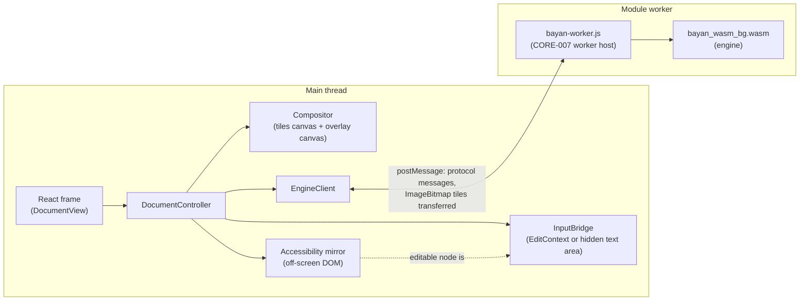

# WEB-002 report: worker canvas, input bridges and accessibility mirror

Work package: [WEB-002](https://github.com/BayanDocs/docs/blob/main/workpackages/phase-0/WEB-002-spike-worker-canvas.md), the validation gate of [ADR-0014](https://github.com/BayanDocs/docs/blob/main/adr/0014-web-shell.md). Engine: bayan-core `e7d6f1e1da00df143f88a6a00e041fc3bc188e3f` (`bayan-core.pin`), CORE-007's engine skeleton and its mock document. The figures were measured with a build of the next commit, `664c999`, which changed nothing the engine package contains: its three runtime files are byte-identical to those of `e7d6f1e` (the pin moved back to `e7d6f1e` because `664c999` had reached bayan-core's main less than 24 hours before it was first pinned, which ADR-0017 rule 4 forbids; `scripts/engine-package.sh` now refuses such a commit). Written 2026-10-12.

## 1. Summary

The web shell now runs the engine the way ADR-0014 planned: bayan-core's WebAssembly package in a module Web Worker, started through one named Trusted Types policy, with the pages drawn on a canvas by a tile compositor, typing and input methods reaching the engine through two input bridges, and screen readers reading an off-screen DOM mirror of the engine's accessibility tree.

In plain language, what this spike shows:

- **Drawing works and stays smooth** in Chromium and Firefox on Linux: scrolling and zooming run at 60 frames a second with no blank frames. Playwright's WebKit keeps up at a device-pixel ratio of 2 on CI's Apple Silicon Mac and at a ratio of 1 on Linux, but not at 2 on Linux in our container, which has no graphics processor. CI's macOS virtual machines also gave two results that point at the machines rather than the code (Chromium at 30 frames a second on Apple Silicon, every browser slow on Intel), which the manual pass on real Macs must settle; section 5 explains and says what to do.
- **Typing and input methods work** through both bridges. Japanese, Chinese and Korean composition reaches the engine through EditContext and through the hidden text area, in Chromium with its input-method emulation; in Firefox and WebKit the hidden text area handles the same composition events correctly. A pass with real input methods in Firefox and Safari is still to be done by hand (section 8).
- **A real screen reader reads the document.** Orca, the Linux screen reader, read the mirror's headings, paragraphs, list and table, and followed the engine's caret while typing, in Firefox and in Chromium; the transcripts are in [WEB-002-evidence/](WEB-002-evidence/). Passes with NVDA and VoiceOver are still to be done by hand (section 9).
- **Keystroke latency is close to PERF-04 but not there yet.** The caret appears within about 16–19 ms at p95 in Chromium and Firefox at a normal typing pace; the typed character itself within 22–35 ms. Section 6 gives the figures and the plan.
- **The security configuration of WEB-001 is unchanged** apart from the one named policy AC-5 allows, and the engine's files are checked against hashes built into the app before the worker starts. Browsers check no integrity on a worker's scripts, so a gap remains, described in section 10.

## 2. What was built



| Part | Files | What it does |
|---|---|---|
| Engine package | `bayan-core.pin`, `scripts/engine-package.sh`, `scripts/check-engine.ts`, `config/engine-files.ts`, `config/engine-plugin.ts` | Builds the package from the pinned bayan-core commit (refusing a commit that is not on bayan-core's `main`) and serves its files unchanged from a content-addressed folder `assets/engine-<digest>/`, with its licence notices in `engine-licenses/`. |
| Worker start | `src/security/script-url-policy.ts`, `src/security/script-url.ts`, `src/engine/start.ts` | The Trusted Types policy `bayan-script-url`; the integrity check of the engine's files; `new Worker()`. |
| Protocol client | `src/engine/client.ts`, `src/engine/protocol.ts` | Requests with ids, replies, events and the worker host's control messages, typed with the package's generated `engine-protocol.d.ts`. |
| Compositor | `src/view/compositor.ts`, `src/view/tiles.ts` | Canvas 2D drawing of transferred `ImageBitmap` tiles: scroll, zoom, device-pixel-ratio changes, stale-tile scaling, partial re-rendering (patches), caret and selection overlays. |
| Input bridges | `src/input/bridge.ts`, `edit-context-bridge.ts`, `hidden-element-bridge.ts`, `keys.ts`, `create-bridge.ts` | One `InputBridge` interface, two implementations; keys, shortcuts from the UI manifest, composition, `beforeinput` and the clipboard, turned into `input.*` messages. |
| Accessibility mirror | `src/a11y/mirror.ts` | Headings, paragraphs, lists and tables from `query.a11y` and `a11y.update`, built with safe DOM APIs only; the editable node is the bridge's element. |
| Wiring and UI | `src/view/document-controller.ts`, `src/DocumentView.tsx`, `src/App.tsx` | The session (hello, manifest, open, view, accessibility tree), the zoom buttons, the status line and the "Engine licenses" link. |
| Measurements | `src/metrics.ts`, `tests/e2e/measurements.spec.ts` | User Timing measures and the figures in sections 5–7. |
| Screen-reader harness | `tests/screen-reader/` | Orca with a virtual display, driven through the X server (section 9). |

### Design decisions taken in the spike

1. **Two canvases under a transparent native scroller.** The tile canvas and the overlay canvas cover the visible area; a scroller above them holds an element sized like the page area, so scrolling, scrollbars, wheels and touch are the browser's own, and the compositor redraws from its tile cache when the scroll position changes. A blinking caret redraws only the overlay canvas.
2. **Tiles of 512 device pixels on a fixed pixel grid per page.** Each tile's rectangle in BLU is derived from whole device-pixel edges, so neighbouring tiles share their edges exactly (unit-tested); the engine maps pixels to BLU exactly within a tile (spec §7).
3. **Stale-tile scaling.** After a zoom or a change of device-pixel ratio, tiles of the previous scale are drawn scaled under the new ones until fresh tiles cover the view; tiles of a page are kept across `view.pages` (which v0 sends after every `view.set`).
4. **Patches.** When the engine invalidates part of a held tile, the compositor asks only for that part, on the tile's own pixel grid, and draws it over the tile. An end-to-end test shows that a patched canvas is byte-identical to one rendered from whole tiles.
5. **One tile request at a time in the worker, overlays drawn at once.** The worker handles messages in order, so a key press waits behind every queued tile; the caret is drawn when `overlay.update` arrives rather than in the next animation frame.
6. **`view.set` only on zoom, device-pixel-ratio or size changes,** never while scrolling, because v0's engine invalidates every page on each `view.set`.
7. **The input bridge's element is the mirror's editable node,** holding the engine's text with its caret where the engine's is, so input methods see the text around the caret and screen readers follow the caret. The engine stays the source of truth: typed text, deletions and pastes are cancelled and sent to the engine, whose answer is written back.
8. **Focus moves to the editable text when the mouse button is released,** and the pages are a focusable, labelled region, so keyboard users can scroll and Tab never traps focus (both from the Orca findings in section 9).
9. **No browser spell checking, autocorrection or capitalization** on the bridge elements: the engine does proofing (ADR-0022), and Chrome's enhanced spell check can send text to a web service.

## 3. Acceptance criteria

| | Criterion | Status | Evidence |
|---|---|---|---|
| AC-1 | Smooth scrolling and zooming in Chromium, Firefox and WebKit (frame-time figures) | Met in Chromium and Firefox on Linux; in WebKit met at device-pixel ratio 1 on Linux and at 2 on CI's Apple Silicon Mac, not at 2 on Linux without a graphics processor nor on CI's Intel Mac | Section 5; `tests/e2e/canvas.spec.ts`, `canvas-hidpi.spec.ts`, `measurements.spec.ts` |
| AC-2 | Japanese, Chinese and Korean composition reaches the engine through EditContext (Chromium) and through the fallback (Firefox and Safari), with evidence | Met with automated evidence; real input methods in Firefox and Safari need the manual pass | Section 8; `tests/e2e/input.spec.ts` |
| AC-3 | A screen reader reads the mirror's text in at least two browser/screen-reader combinations, with evidence | Met with Orca 46.1 + Firefox 155 and Orca 46.1 + Chromium 141; NVDA and VoiceOver passes are scripted for the owner | Section 9; [WEB-002-evidence/](WEB-002-evidence/); `tests/e2e/a11y.spec.ts` |
| AC-4 | Keystroke-to-overlay latency reported, with a plan to meet PERF-04 if it is not met | Met: reported; PERF-04 not yet met; plan in section 6.4 | Section 6 |
| AC-5 | CSP and Trusted Types unchanged except the one named policy `bayan-script-url` … tests in three engines | Met | Section 10; `tests/unit/security-headers.test.ts`, `tests/unit/trusted-types.test.ts`, `tests/e2e/engine.spec.ts` |

## 4. How the figures were measured

- **Machine:** a cloud container with 4 virtual cores (Intel Xeon, 2.8 GHz), 15 GB of memory and **no graphics processor**: every browser rasterizes and composites in software.
- **Browsers:** Playwright 1.63.0's builds, headless: Chromium 153.0.8010.12 (headless shell), Firefox 155.0, WebKit 26.6. Chromium and Firefox run at a device-pixel ratio of 1; WebKit runs Playwright's "Desktop Safari" profile, which has a ratio of 2 (four times the pixels), and was measured at 1 as well for comparison.
- **Method:** `tests/e2e/measurements.spec.ts`, one browser at a time (`--workers 1`), against the production build served by `vite preview`, two runs; where the runs differ the table gives both. The app records User Timing measures (`src/metrics.ts`); the tests read them and the per-frame state of the compositor.
- **Definitions:** *key → caret drawn*: from the `keydown` event to the moment the compositor drew the engine's new caret. *Key → caret frame*: to the next animation frame after that, when the browser renders it; this is the figure to compare with PERF-04's keystroke-to-pixel for the caret. *Key → character*: to the frame in which the re-rendered tile (or patch) that shows the typed character was drawn. *Steady typing*: 44 characters at one every 80 ms (about 12 a second, a fast typist). *Burst*: 40 characters as fast as Playwright sends them, far faster than anyone types, to show queuing.

CI runs the same measurements on Ubuntu 24.04, macOS 15 (Apple Silicon) and macOS 26 (Intel) and keeps them as the `measurements-<runner>` artifacts of each run; sections 5 and 6 give the macOS figures of one such run.

## 5. AC-1: scrolling and zooming

Scrolling: the test scrolls the whole document down and back at 1,500 CSS pixels a second, one step per animation frame. Zooming: eight zoom steps (100 → 110 → 125 → 150 → 125 → 110 → 100 → 90 → 75 %). Frame intervals in milliseconds (p50 / p95 / p99), and frames that showed stand-ins or placeholders:

| Browser | Scroll frames p50 / p95 / p99 | Frames over 33 ms | Frames waiting for fresh tiles | Frames with a blank page | Zoom frames p50 / p95 / p99 | Zoom: frames over 33 ms / blank |
|---|---|---|---|---|---|---|
| Chromium | 16.7 / 16.7 / 16.7 | 0 | 0 | 0 | 16.7 / 16.7 / 16.7 | 0 / 0 |
| Firefox | 16.3–16.4 / 17.3 / 17.3 | 0 | 0 | 0 | 16.3–16.4 / 17.2 / 17.3 | 0 / 0 |
| WebKit, ratio 1 | 18.3 / 23.5 / 33.7 | 2 of 199 | 0 | 0 | 18.4 / 30.9 / 36.7 | 3 / 0 |
| WebKit, ratio 2 | 60.7–62.8 / 72.7 / 87–92 | 59–61 of 67–68 | 36–37 | 12–13 | 62.8–63.3 / 75–77 / 79–83 | 131 / 0 |

While zooming, 66–110 frames per run showed the previous scale's tiles scaled (stale-tile scaling) while fresh tiles arrived, and **no frame showed a blank page** in any browser. `canvas.spec.ts` checks this on every frame of five zoom steps, and that the page area at devicePixelRatio 2 is rendered at device resolution in all three engines; in Chromium it also changes the ratio of a running page.

**WebKit at a ratio of 2.** Every scroll step redraws the whole canvas (2,560 × 1,100 device pixels here) from tiles, which Playwright's WebKit on Linux does in software in this container at about 16 frames a second; at a ratio of 1 the same code runs at about 55. The figures for macOS come from CI and from the manual pass; real Safari composites on the graphics processor. Should WebKit stay slow on real Macs, the remedy is to let the browser scroll the tiles itself: put the tiles in the scrolled content as small canvases (`ImageBitmapRenderingContext.transferFromImageBitmap`, no copy), so that scrolling needs no drawing by the page at all and continues even while the main thread is busy. That changes the compositor's structure, not the protocol; it is follow-up F5.

**macOS in CI.** The same measurements, once each, from GitHub's macOS virtual machines (the `measurements-macos-15` and `measurements-macos-26-intel` artifacts of [CI run 38194327872](https://github.com/BayanDocs/bayan-web/actions/runs/38194327872), on commit `c2c64dc`). WebKit runs Playwright's "Desktop Safari" profile there, at a ratio of 2; Chromium and Firefox at 1. These are shared virtual machines running Playwright's builds, not Safari or Chrome on a person's Mac, so they show tendencies rather than final values:

| Machine, browser | Scroll frames p50 / p95 / p99 | Frames over 33 ms | Frames waiting for fresh tiles / with a blank page | Zoom frames p50 / p95 / p99 | Zoom: frames over 33 ms / blank |
|---|---|---|---|---|---|
| macOS 15 (Apple Silicon), Chromium | 33.3 / 66.7 / 66.7 | 43 of 108 | 0 / 0 | 33.3 / 66.7 / 66.7 | 54 / 0 |
| macOS 15 (Apple Silicon), Firefox | 16.7 / 19.9 / 22.5 | 0 of 220 | 0 / 0 | 16.3 / 20.1 / 22.2 | 0 / 0 |
| macOS 15 (Apple Silicon), WebKit, ratio 2 | 16.7 / 19.2 / 23.7 | 1 of 222 | 6 / 0 | 16.6 / 18.0 / 20.8 | 0 / 0 |
| macOS 26 (Intel), Chromium | 16.7 / 100 / 116.7 | 18 of 134 | 0 / 0 | 16.7 / 100 / 133.3 | 22 / 0 |
| macOS 26 (Intel), Firefox | 31.4 / 32.9 / 63.1 | 2 of 118 | 1 / 0 | 31.2 / 32.6 / 33.3 | 0 / 0 |
| macOS 26 (Intel), WebKit, ratio 2 | 33.2 / 149.6 / 210.9 | 40 of 81 | 66 / 21 | 33.1 / 128.1 / 508.7 | 118 / 0 |

On the Apple Silicon machine, WebKit at a ratio of 2 scrolled and zoomed at 60 frames a second, with no blank page, which supports the explanation above: the slowness on Linux comes from drawing in software, not from the compositor's design. Two results there are not yet explained. Playwright's Chromium headless shell presented only every second frame on the Apple Silicon machine (every interval a multiple of 16.7 ms), while Firefox and WebKit on the same machine kept 60. The Intel machine was slow for every browser, Firefox included (about 32 frames a second), and WebKit there showed a blank area in 21 frames while scrolling, the only blank frames in any measurement. Both point at the virtual machines rather than the code, since the same code ran at 60 frames a second elsewhere, but only the manual pass on real Macs (section 8.2) can settle it; should real Safari on an Intel Mac show blank areas while scrolling, F5 applies.

## 6. AC-4: keystroke latency

### 6.1 Final figures

p50 / p95 / p99 in milliseconds, two runs:

| Browser | Steady: key → caret drawn | Steady: key → caret frame | Steady: key → character | Burst: key → caret frame | Burst: key → character |
|---|---|---|---|---|---|
| Chromium | 1.2–1.3 / 1.6–2.2 / 2.8–8.4 | 2.3–12.1 / 3.6–18.0 / 18.7–25.1 | 17.0–28.4 / 22.0–35.1 / 40.8–41.0 | 58.7–65.9 / 89.2–99.5 / 92–107 | 62.1–70.0 / 89–111 / 92–112 |
| Firefox | 2.2 / 2.9–3.1 / 3.7 | 11.6–12.6 / 18.3 / 19.6 | 14.9–15.5 / 22.2–23.1 / 26.3–28.1 | 9.2–9.5 / 15.9–17.2 / 19.4–19.9 | 9.1–9.5 / 17.8–19.7 / 19.8–25.3 |
| WebKit, ratio 1 | 1.9 / 3.0 / 7.3 | 11.5 / 17.3 / 20.4 | 28.0 / 37.7 / 39.9 | — | — |
| WebKit, ratio 2 | 3.4–3.8 / 28.7–29.4 / 31.7–35.0 | 21.8–23.8 / 51.4–57.1 / 55–60 | 21.7–23.7 / 54–58 / 103–117 | 35.8–38.5 / 70–73 / 77–81 | 35.7–39.4 / 70–73 / 77–80 |

On CI's macOS virtual machines (one run each, the artifacts named in section 5):

| Machine, browser | Steady: key → caret drawn | Steady: key → caret frame | Steady: key → character | Burst: key → caret frame | Burst: key → character |
|---|---|---|---|---|---|
| macOS 15 (Apple Silicon), Chromium | 10.7 / 60.4 / 123.5 | 51.9 / 112.3 / 200.7 | 69.9 / 133.9 / 213.4 | 78.2 / 101.4 / 104.9 | 77.4 / 100.7 / 104.2 |
| macOS 15 (Apple Silicon), Firefox | 2.1 / 3.6 / 4.3 | 11.6 / 19.4 / 21.9 | 13.4 / 30.1 / 39.4 | 7.8 / 14.8 / 16.4 | 7.7 / 14.7 / 16.3 |
| macOS 15 (Apple Silicon), WebKit, ratio 2 | 1.4 / 5.4 / 5.8 | 9.4 / 19.4 / 22.0 | 9.6 / 23.2 / 35.1 | 7.0 / 17.1 / 17.7 | 7.2 / 20.6 / 28.5 |
| macOS 26 (Intel), Chromium | 1.7 / 73.8 / 106.2 | 8.7 / 128.8 / 163.7 | 25.4 / 163.7 / 228.9 | 70.4 / 103.6 / 108.0 | 70.2 / 103.5 / 107.9 |
| macOS 26 (Intel), Firefox | 1.3 / 4.4 / 13.9 | 19.7 / 34.5 / 48.7 | 52.2 / 68.1 / 105.0 | 25.0 / 85.9 / 99.1 | 25.5 / 85.2 / 98.5 |
| macOS 26 (Intel), WebKit, ratio 2 | 11.7 / 50.2 / 71.5 | 31.8 / 73.2 / 129.7 | 34.4 / 105.7 / 129.6 | 42.7 / 142.0 / 164.6 | 51.2 / 159.1 / 184.3 |

Firefox and WebKit on the Apple Silicon machine match the Linux figures, WebKit now at a ratio of 2 (caret frame 19.4 ms at p95, against 51–57 on Linux), and in bursts come within 1–2 ms of PERF-04 for the caret. Chromium's headless shell there and every browser on the Intel machine are slower, in line with their frame times above.

The engine's own work is small: once the worker answers, the caret is drawn within 1–3 ms (*key → caret drawn*). What remains is waiting: for the next frame (up to 16.7 ms at 60 Hz), and in bursts for the worker, which handles one message at a time.

### 6.2 What the spike changed, and what it gained

The first measurements, before the three changes below, gave at p95: Chromium 18.6 ms to the caret frame and 30.0 ms to the character with steady typing, 83.8 / 77.1 ms in bursts; Firefox 32.4 and 29.3 ms steady, 29.1 and 31.7 ms in bursts; WebKit (ratio 2) 159.5 and 88.0 ms steady.

1. **Drawing the caret at once** instead of in the next animation frame removed up to one frame from every keystroke (Firefox: 32.4 → 18.3 ms at p95, steady; WebKit: 159.5 → 51–57 ms).
2. **One tile request at a time in the worker** (it was two) shortened the queue a key press can find in front of it.
3. **Patches instead of whole tiles:** typing changes a strip about 35 pixels tall, and the compositor had been asking for two whole 512 × 512 tiles per key press. A patch now costs a round trip of 2.4–4.9 ms at p50 in Chromium and Firefox instead of 12–20 ms for a whole tile (WebKit at ratio 2: 30 instead of 51), and Firefox's burst went from 31.7 to 17.8–19.7 ms at p95, key to character.

### 6.3 Against PERF-04

PERF-04 asks for keystroke-to-pixel latency of at most 16 ms at p95 and 33 ms at p99. With steady typing, **the caret meets the p99 bound in Chromium, Firefox and WebKit at ratio 1, and misses the p95 bound by 1–3 ms in Firefox, in WebKit at ratio 1 and in one of two Chromium runs; the character misses the p95 bound everywhere (22–38 ms) and the p99 bound everywhere but in Firefox**. Bursts miss in Chromium and WebKit at ratio 2. These are headless browsers on a shared machine without a graphics processor, with the mock engine's trivial layout; real hardware will be faster for drawing and the real engine slower for layout, so the figures show the shape of the costs more than final values.

### 6.4 Plan to meet PERF-04

1. **Measure on real hardware first** (owner, with the manual script of section 8.2): Chromium, Firefox and Safari on a Mac and on Windows, 60 Hz and 120 Hz screens. PERF-04's 16 ms at p95 is less than one 60 Hz frame including the wait for that frame, so on a 60 Hz screen it requires the engine's answer and the drawing to fit within the frame in which the key arrives.
2. **Keep the main thread and the worker free when a key arrives:** coalesce typed characters while a previous `input.text` is unanswered into one message (bursts), and never let tile work queue ahead of input (follow-up F6). Both are shell changes.
3. **Render less per keystroke in the engine:** the engine already renders any rectangle; with the real rasterizer (ADR-0011, CORE-003), the shell should ask only for invalidated lines, which patches already do. The engine should invalidate the smallest region that changed.
4. **Present sooner:** try a `desynchronized` 2D context for the overlay canvas, which lets Chromium show the caret without waiting for the compositor's next frame (follow-up F7), and draw the character as soon as its patch arrives (already done).
5. **Move rasterization off the engine's message queue** in Phase 2, when the engine can use threads (ADR-0014 §8): a render thread or a second worker for tiles, so that input messages never wait behind rendering.
6. **Re-measure in WEB-101** with the real engine, and record PERF-04's status in the Phase 1 gate review.

## 7. Worker messages, start-up and memory

Round trips (main thread → worker → main thread, p50, ms): `hello` 56–115 (the first message also waits for the module's compilation), `ui.manifest` 1.8–10.8, `doc.open` 0.7–38.6, `view.set` 0.5–2.0, `query.a11y` 8–18, `render.tile` for a whole tile of 512 × 512 device pixels 7.6–17.8 (the upper end is WebKit). `input.text` during the burst: 0.8–2.2 at p50 in Firefox and WebKit, 50–52 in Chromium, where the burst queues in the worker.

Start-up: checking the engine's three files and starting the worker took 24–65 ms; the worker host reported ready 110–165 ms after the start; the engine was ready 235–455 ms after navigation began.

Memory: the compositor's tiles take 3.3 MB for the first page at ratio 1 (4 tiles) and 10 MB at ratio 2 (12 tiles), with a budget of 160 MB before the least recently drawn tiles are dropped. Chromium's main-thread JavaScript heap was about 10 MB (`performance.memory`, quantized); `performance.measureUserAgentSpecificMemory()`, which would include the worker and its WebAssembly memory, is not available in Playwright's headless shell, so whole-page memory is part of the manual pass.

Download size (gzip): the app without the engine 100.3 KB, the engine package with its licence notices 239.9 KB, everything 340.3 KB; PERF-06 allows 5 MB.

## 8. AC-2: input methods

### 8.1 Automated evidence

`tests/e2e/input.spec.ts` records every `input.*` message the app posts to the worker (by wrapping `Worker.prototype.postMessage` before the app starts) and checks three things: the messages, the engine's answer (the editable text it sends back, which the bridge's element shows) and the engine's pixels (the mock document draws composition text as blue boxes with an underline and committed text as dark boxes).

- **Chromium, EditContext:** the DevTools protocol's input-method emulation (`Input.imeSetComposition`, `Input.insertText`) composes Japanese (に → にほ → にほん → にほんご → 日本語, committed as 日本語), Chinese (pinyin z → zh → zhong → zhong'w → zhong'wen, committed as 中文) and Korean (ㅎ → 하 → 한, then ㄱ → 구 → 국). The engine receives `start`, every `update` with its text, a last `update` with the committed text, `end`, then `input.text`; while composing it draws the blue boxes; afterwards its text is 日本語中文한국 and the bridge's caret is after it.
- **Chromium, hidden text area:** the same, with EditContext removed before the app starts, so the app chooses the bridge Firefox and Safari use.
- **Firefox and WebKit, hidden text area:** Playwright cannot drive an input method in these engines, so the test replays the events a browser fires on the text area while an input method composes (`compositionstart`, `compositionupdate` and `input` with `insertCompositionText` for each step, the commit as a last update, `compositionend`), in the real browser engines. The engine receives the same messages and ends with the same text.
- Typing, Backspace, arrows, Home and End, the UI manifest's shortcuts (sent to the engine) and the clipboard shortcuts (left to the browser), Shift+Tab out of the document, and pasting plain text are tested in all three engines.

What is not covered automatically: real input methods in Firefox and Safari, which differ in event order (Firefox sends `compositionend` before the last `input` event; Safari sends the key that ends a composition after `compositionend`, with keyCode 229, which the bridge ignores), candidate-window placement, Korean IMEs that commit each syllable, and dead keys and emoji pickers (I18N-07).

### 8.2 Manual input-method script (owner)

Run `pnpm build && pnpm preview` and open http://localhost:4173 in each browser. Click on the first page; the editable line is the yellow box. Then, with each input method:

| Step | Japanese (macOS: Japanese – Romaji; Windows: Microsoft IME) | Chinese (Pinyin – Simplified; Microsoft Pinyin) | Korean (2-Set Korean; Microsoft Korean IME) |
|---|---|---|---|
| Type | `nihongo` | `zhongwen` | `gksrnr` |
| While composing, expect | blue boxes with an underline in the yellow box; the candidate window next to them | the same | the same, one syllable at a time |
| Convert and commit | Space, then Enter | Space or 1 | (commits itself; then Space) |
| Expect after commit | three dark boxes (日本語); no new line | two dark boxes (中文) | two dark boxes (한국) and a space |
| Backspace during composition | removes the last kana, not committed text | removes the last letter | removes the last jamo |

Also try: a dead key (Option+E then E on a US keyboard gives é), the emoji picker (Ctrl+Cmd+Space on macOS, Windows+. on Windows), and reconversion where the system offers it. Record for each: browser and version, system, input method, result (pass, fail and what happened), and a screenshot.

| Browser | System | Japanese | Chinese | Korean | Dead key | Emoji | Notes |
|---|---|---|---|---|---|---|---|
| Safari | macOS | to do | to do | to do | to do | to do | |
| Firefox | macOS or Windows | to do | to do | to do | to do | to do | |
| Chrome | macOS or Windows | to do | to do | to do | to do | to do | |

## 9. AC-3: screen readers

### 9.1 Evidence with Orca

Orca 46.1 (Ubuntu 24.04's package) ran against a visible Firefox 155 and Chromium 141 on a virtual display in this container, with a debug log of everything it spoke. `tests/screen-reader/orca.ts` pressed keys and clicked through the X server (so Orca noticed them, as with a person at the keyboard) and wrote the transcripts in [WEB-002-evidence/orca-firefox.txt](WEB-002-evidence/orca-firefox.txt) and [WEB-002-evidence/orca-chromium.txt](WEB-002-evidence/orca-chromium.txt). Excerpts from Chromium; Firefox's are the same apart from the browser's own announcements:

```text
ORCA 'Page has 4 landmarks, 5 headings, 1 table, 2 unvisited links.'
STEP h: next heading
ORCA 'BayanDocs mock document heading level 1.'
STEP Down x3: the next lines
ORCA 'This document stands in for real documents until the engine can open them. Its text is drawn as grey bars, but screen readers …'
STEP l: next list
ORCA 'List with 3 items'
ORCA '• Scrolling and zooming across pages.'
STEP t: next table
ORCA 'table with 3 rows 3 columns'
ORCA 'Shell column header Desktop.'
ORCA 'Toolkit column header Qt Quick.'
STEP Tab, Tab: the Pages region, then the editable line
ORCA 'Editable line entry.'
ORCA 'Focus mode'
STEP type 'Hi'
ORCA 'H'   ORCA 'i'
STEP Left: the caret moves before 'i'
ORCA 'i'
STEP Left: the caret moves before 'H'
ORCA 'H'
STEP BackSpace: deletes 'H'
ORCA 'H'
STEP the engine's editable text is now "i"
```

So Orca read the mirror's text and structure in both browsers, and followed the engine's caret through both bridges: EditContext in Chromium, the hidden text area in Firefox. Three problems found this way were fixed in this pull request:

1. In Chromium, a mouse click on the page moved focus to the editable text on pointer press, and Orca stayed in browse mode and took the user's typing as its own commands (letters such as H jump between headings); focus now moves on release, and Orca switches to focus mode in both browsers.
2. Firefox took the mirror's table, which it cannot see on screen, for a layout table: Orca did not count it and its table navigation did not find it. The table now has an explicit `role="table"`.
3. Chromium's spell checker ran on the editable text (Orca announced "misspelled"); browser spell checking is now off on both bridges.

The harness also needed to switch off Orca's "read the page on load" (`tests/screen-reader/start-orca.sh`): without a speech synthesizer in the container, Orca never learns that reading finished and stays in that mode.

`tests/e2e/a11y.spec.ts` checks, in all three engines, what screen readers are given: the mirror's structure as an accessibility snapshot (document, headings with levels, paragraphs, the textbox, the list and its items, the table with its column headers and cells), that the canvases are hidden from assistive technology, Chromium's own accessibility tree, and that the textbox holds the engine's text with its caret where the engine's caret is.

### 9.2 Manual screen-reader script (owner)

ADR-0014's validation gate names NVDA with Firefox or Chrome and VoiceOver with Safari. Run the build as in 8.2.

| Step | NVDA (Firefox or Chrome, Windows) | VoiceOver (Safari, macOS) | Expect |
|---|---|---|---|
| Open the page | — | VO+U, Headings | 5 headings: BayanDocs mock document (level 1), A short list, A small table, Why a mock document, The last page |
| Next heading | H | VO+Cmd+H | "BayanDocs mock document, heading level 1" |
| Read on | Down arrow ×3 | VO+Right ×3 | the two paragraphs, then the editable line |
| Next list | L, then Down ×3 | VO+Cmd+X, then VO+Right | "list with 3 items" and each item |
| Next table | T, then Ctrl+Alt+arrows | VO+Cmd+T, then VO+arrows | "table with 3 rows and 3 columns"; cells read with their column headers |
| Into the editable line | Tab until "Editable line, edit" (focus mode) | Tab until "Editable line, edit text" | the screen reader switches to focus mode or interacts with the field |
| Type `Hi`, then Left, Left, Right, Backspace | | | echoes H, i; reads i, H, i; announces the deleted H |
| Click on the first page, then type | mouse | mouse or VO+Space | focus mode, and the typed text is echoed |

| Combination | Reading | Structure (headings, list, table) | Editing and caret | Notes |
|---|---|---|---|---|
| NVDA + Firefox | to do | to do | to do | |
| NVDA + Chrome | to do | to do | to do | |
| VoiceOver + Safari | to do | to do | to do | |

## 10. AC-5: Trusted Types and the integrity of the engine's files

### 10.1 Content Security Policy and the policy

The Content Security Policy is WEB-001's with one change: `trusted-types 'none'` became `trusted-types bayan-script-url`. A unit test compares the whole policy with WEB-001's, directive by directive, and `deploy/nginx/security-headers.conf` repeats it (kept equal by the existing test). Without `'allow-duplicates'`, once the app has created the policy no code can create another of that name, and no other name is allowed.

`src/security/script-url-policy.ts` creates the policy, the first time a worker starts, and is the only file in `src/` that mentions `createPolicy` (`tests/unit/trusted-types.test.ts` fails otherwise). The policy implements `createScriptURL` only, and accepts exactly the paths in its allowlist, which the build writes: today the engine's worker host, `/assets/engine-<digest>/bayan-worker.js`. It refuses every other address, without repeating it in the error: other origins, the same origin written out, protocol-relative addresses, `blob:`, `data:` and `javascript:` URLs, query strings (even empty), fragments, relative paths, paths that walk up or contain percent-escapes or backslashes, the app's other scripts, and anything that is not a string. Unit tests check each case; `tests/e2e/engine.spec.ts` checks in Chromium, Firefox and WebKit that the worker starts through the policy, that the policy refuses forbidden addresses and HTML or script text, that no second policy can be created, and that `new Worker()` refuses a plain string.

### 10.2 What browsers check for a worker

The brief asked for an integrity plan for the worker's scripts. An experiment in all three browsers, with our production headers on every response, showed that **none of them checks integrity for a worker's script, the module it imports or the WebAssembly it fetches**: the worker starts and runs although none of those requests carries integrity metadata, while the page's own scripts without a hash are blocked. This matches the specifications: `Integrity-Policy` blocks only requests whose destination is `script` or `style`, and `new Worker()` takes no integrity option. So the browser cannot be asked to check the engine's files; the app has to.

### 10.3 The plan, as implemented

1. **Only the built worker can start.** The policy's allowlist is the exact path of the engine's worker host, written into the app by the build.
2. **The app knows what the engine's files must be.** The build serves the three runtime files unchanged, byte for byte, from a content-addressed folder, and writes their SHA-384 hashes into the app's own bundle (`virtual:bayan-engine`), which `index.html` loads with an integrity hash; the chain of trust is `index.html` → bundle → engine files.
3. **The app checks them before it starts the worker.** `src/engine/start.ts` fetches all three files with `fetch(url, { integrity })`; if any differs by a single byte, or cannot be fetched, the worker is never started and the status line says so. `engine.spec.ts` changes each of the three files in turn and checks, in all three engines, that the engine stops and no worker is created.
4. **The worker loads what was checked.** The folder is content-addressed and cached for a year (`deploy/nginx`), so the worker's own requests are answered from the cache entries the check just filled.
5. **The build fails closed for everything else.** `scripts/sri.ts` accepts exactly the engine's two scripts at their paths, and only if they are byte-identical to the engine package; any other script without a hash still fails the build (unit-tested).

### 10.4 The remaining gap

The browser does not bind the worker's load to the bytes the app checked. A server, cache or intermediary that serves the checked bytes to the app's `fetch()` and different bytes to the worker's own request is not detected; in practice that requires control of the origin or an intermediary that can tell the two requests apart, while the attack SRI is designed against, a tampered file at rest in a cache or a CDN, is detected. Ways to close it, none possible within this work package:

- **The module (small, in bayan-core):** let the worker host's `init` message carry the module's integrity hash and fetch the module with it (follow-up F1). Then only the two scripts remain.
- **The scripts:** a service worker (the PWA of ADR-0014 §10) can check every response against a manifest of hashes before the page or a worker sees it, though its own script is again loaded without integrity; or a browser feature: integrity for `new Worker()`, or `Integrity-Policy` for the worker destination. Neither exists today; WEB-002 recommends raising it with the Web Application Security working group (follow-up F2).

## 11. Findings for the protocol and the engine

1. **`view.set` invalidates every page** in v0, even when only the viewport moved. The shell therefore sends it only on zoom, device-pixel-ratio and size changes. The engine should invalidate only what a change affects (F3).
2. **No message replaces or deletes a range.** Spelling suggestions (`insertReplacementText`), input-method reconversion (an EditContext `textupdate` with a non-empty range) and deletions by word or line need a range; v0 inserts at the caret only. The bridges switch the browser's suggestions off and forward deletions as keys with modifiers (F3).
3. **No clipboard exchange.** Pasting forwards plain text as `input.text`; other formats must reach the engine as raw bytes, never decoded by the browser (ADR-0006), and copy and cut need content from the engine (`host.clipboard.write` exists in the catalog, not in v0) (F3).
4. **Surrounding text for input methods** (`input.ime.query` in the catalog) was not needed: the editable accessibility node already carries the text and the box of every character, which EditContext's `updateCharacterBounds` uses. The real engine's editable text is a whole document, so the bridge will need a window of text around the caret; the protocol should say how large (F3).
5. **The worker host converts every pixel** from premultiplied to straight alpha in JavaScript before creating the `ImageBitmap`; with patches this matters less, but an engine that produced straight alpha for the web, or a faster conversion, would cut tile time (F4).
6. **The WebAssembly module contains the builder's path** to Cargo's registry (`/root/.cargo/registry/…`), so two machines with different home folders build different bytes, although two checkouts on one machine build identical ones. Remapping those paths would make the package reproducible across machines and its hash comparable with bayan-core's CI artifacts (F4).
7. **`input.key` carries the modifiers as pressed** (`{ shift, ctrl, alt, meta }`, spec §6.5), and the UI manifest's shortcuts say "Ctrl", which the shell reads as the platform's primary modifier, Command on Apple systems (the spec does not say which). So on a Mac the shell forwards Command+B for the manifest's "Ctrl+B" with `meta` set and `ctrl` not, and the engine cannot tell it is the same shortcut without knowing the platform. Either the shell names the platform once (for example in `hello`), or `input.key` gains a `primary` flag, or the shell sends shortcuts as commands; CI's macOS runs found this, through a test that pressed Control on a Mac (F3).

## 12. Follow-ups

| | Follow-up | Where | Size |
|---|---|---|---|
| F1 | Worker host: accept the module's integrity hash in `init` and fetch with it | bayan-core | S |
| F2 | Raise integrity for workers (`new Worker()` option or `Integrity-Policy` for workers) with the standards bodies; revisit when a browser ships one | docs, owner | S |
| F3 | Protocol additions: range replacement and deletion, clipboard exchange as bytes, a text window for input methods, narrower invalidation on `view.set`, the platform's primary shortcut modifier | docs spec, then bayan-core (CORE-125) | M |
| F4 | Engine package: straight-alpha or faster tile conversion; reproducible module across machines | bayan-core | S |
| F5 | Compositor: let the browser scroll the tiles (tile canvases in the scrolled content) if WebKit or Safari stays below 60 frames a second at ratio 2 on real hardware | bayan-web, WEB-101 | M |
| F6 | Input: coalesce typed text while an `input.text` is unanswered; keep tile work behind input | bayan-web, WEB-101 | S |
| F7 | Try a `desynchronized` 2D context for the overlay canvas, and measure on real 60 and 120 Hz screens | bayan-web | S |
| F8 | Manual passes: real input methods (8.2) and NVDA and VoiceOver (9.2), with results in this report | owner | S |
| F9 | Automated accessibility rules (axe, ADR-0014 §3) in the end-to-end tests: a new dependency, to be justified | bayan-web, WEB-102 | S |
| F10 | Mirror aligned with the page (each node at its bounds), so VoiceOver's cursor and touch exploration match what is drawn | bayan-web, WEB-102 | M |
| F11 | Cloud environment: build the engine package in the setup script (`BAYAN_CORE_DIR=/home/user/bayan-core scripts/engine-package.sh`) | docs, with the batched environment changes of docs issue 7 | S |
| F12 | Run the Orca harness in CI (a nightly job on Ubuntu with the Ubuntu packages it needs) | bayan-web | M |

## 13. Reproducing

```sh
scripts/dev-setup.sh                      # Node.js, pnpm, packages, browsers
scripts/engine-package.sh                 # the engine package from bayan-core.pin
pnpm verify                               # everything, measurements included
pnpm exec playwright test tests/e2e/measurements.spec.ts --workers 1   # the figures alone, in test-results/measurements/
```

Screen-reader evidence (Ubuntu 24.04): install `orca at-spi2-core dbus-x11 python3-pyatspi xdotool xvfb` from the Ubuntu archive, then

```sh
pnpm build && pnpm preview &              # serves the build on port 4173
tests/screen-reader/start-orca.sh /tmp/orca
. /tmp/orca/env.sh
node tests/screen-reader/orca.ts firefox /tmp/orca docs/spikes/WEB-002-evidence/orca-firefox.txt
CHROMIUM_EXECUTABLE=<a full Chromium build> node tests/screen-reader/orca.ts chromium /tmp/orca docs/spikes/WEB-002-evidence/orca-chromium.txt
```
